# Jatra: what's on in Bhubaneswar

**Subham Shah** · Roll No. **24155739**

An event management website for one city. Visitors find events in Bhubaneswar, book tickets and carry a QR ticket. Organizers publish events, sell them in ticket tiers and track sales. *Jatra* (ଯାତ୍ରା) is Odia for a festival procession, and the site is built around that idea.

**Live site:** https://jatra-bhubaneswar.vercel.app

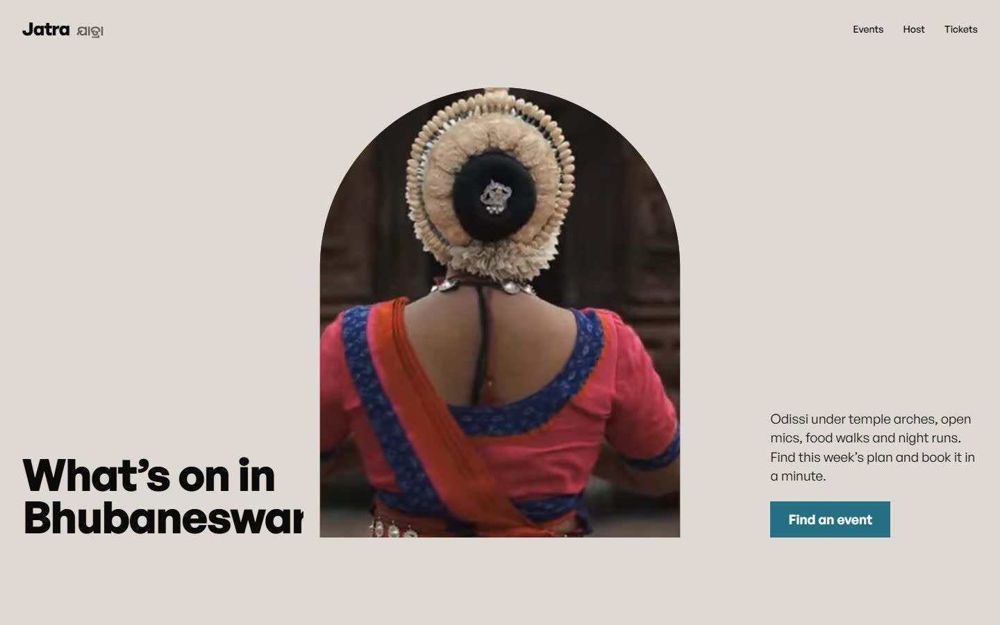

---

## The brief, point by point

Built for **K Explore: Web Designing**, *Design and Develop a Responsive Event Management Website*.

| The brief asks for | Where it is |
| --- | --- |
| An attractive hero section introducing the platform | Home: the torana-shaped window onto a film of the city that opens to full screen as you scroll ([Hero.tsx](src/components/Hero.tsx)) |
| A section showcasing upcoming and featured events | Home: **This season** (featured, the procession), **This week** (upcoming, by day) and **Coming up** (two featured close-ups) |
| Event cards with name, date, venue, image and a short description | Every poster card on [/events](https://jatra-bhubaneswar.vercel.app/events) and under each event ([Poster.tsx](src/components/Poster.tsx)); the featured cards on the home page |
| Browse, search, and filter by category | [/events](https://jatra-bhubaneswar.vercel.app/events): search box, category chips, plus date, area, price and sort ([Browse.tsx](src/components/Browse.tsx)) |
| Event details with a registration option | Each event page: summary, programme, schedule, venue, host, tickets and a **Book** button ([EventView.tsx](src/components/EventView.tsx)) |
| Registration form: name, email, phone number and selected event | The booking dialog has the **Event** (filled in from the page you are on), **Name**, **Email** and **Phone number** |
| JavaScript form validation | Name (at least 2 characters), email (pattern), phone (Indian mobile: 10 digits starting 6 to 9, optional +91 or 0). Errors appear under each field, focus moves to the first one, and each clears as it is fixed. The host form validates too, with an error summary |
| A confirmation message after submitting | "You're going", the line *Booking confirmed, {name}…*, and the ticket printing in with its QR code |
| Responsive on phones, tablets and desktops | Checked at 390, 768, 1280, 1440 and 1920px; each home section has its own phone layout |
| HTML5, CSS3, JavaScript (React and Tailwind allowed) | Semantic HTML5 (landmarks, `<dialog>`, `<details>`, `<time>`), one hand-written CSS3 stylesheet, and React through Next.js, written in TypeScript (compiled to JavaScript), with Tailwind for the reset |
| Git and GitHub | This repository |
| **Bonus:** dark/light mode | The half-circle button in the header. It follows the system setting until you choose, remembers your choice, and the new theme wipes down over the old one |
| **Bonus:** event countdown timers | Live day/hour/minute/second countdown on every event page, on the featured cards on the home page, and on each ticket in My tickets |
| **Bonus:** animations | See [Motion](#motion) below |
| **Bonus:** localStorage registration data | Bookings (with name, email and phone) and hosted events are saved in `localStorage` ([store.ts](src/lib/store.ts)); see them under My tickets and Your events |
| Deployed link and README | https://jatra-bhubaneswar.vercel.app on Vercel, and this file |

## What you can do

**As an attendee**

- Browse every event over the next three weeks. Search, then filter by category, date (today, this weekend, next 7 or 30 days), area and price, and sort by date or price. Filters live in the URL, so a filtered view can be shared.
- Open an event: summary, programme, schedule, venue with a Google Maps link, host, and "good to know" notes.
- Book: pick quantities per ticket tier (seats left update live), register with your name, email and phone number (validated as you type), and the ticket "prints" with a scannable QR code, a ticket code and a confirmation message.
- A live countdown to the start of every event.
- Light and dark themes, following your system until you pick one.
- My tickets: every booking with its QR code, *Add to calendar* (.ics), *View event*, and *Cancel booking*. Cancelling returns the seats.
- Share an event (native share sheet on phones, copy link on desktop).

**As an organizer**

- Host an event: title, category, host, summary, description, date and times, venue, area, cover picture (choose one or upload your own, resized in the browser) and up to four ticket tiers (free tiers allowed).
- A live poster preview updates as you type.
- Validation with an error summary that links to each field. Each error clears as its field is fixed.
- Your events dashboard: events listed, tickets sold, takings, a sold/capacity bar per event, and *View*, *Edit* and *Delete* (with confirmation).
- Published events appear straight away in the browse list, search, filters and booking flow.

> **Demo scope.** There is no backend: bookings and hosted events are saved in the visitor's browser (`localStorage`). Checkout is a free demo and takes no payment, and nothing you enter leaves the browser. The sample events, venues' programmes and hosts are fictional, and their dates are generated relative to today so the listings never go stale.

## Screens

| | |
| --- | --- |
| 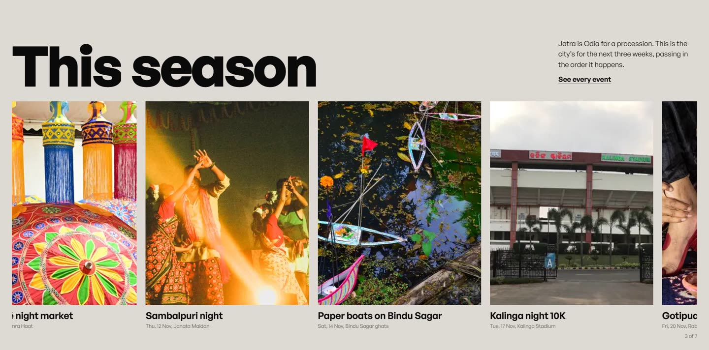 | 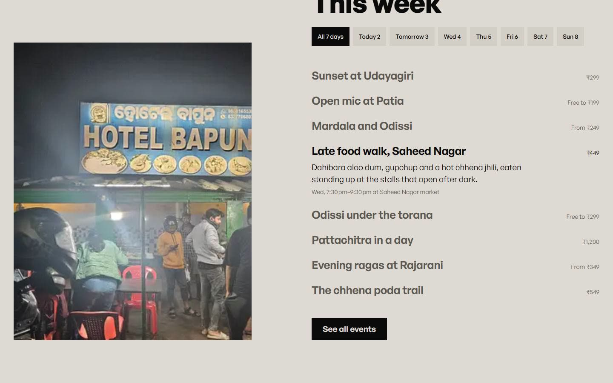 |
| **This season.** The title holds while the season's headline events pass sideways, the procession the name is about. | **This week.** Pick a day; the row at the middle of the screen lights up and its photograph crossfades in. |
| 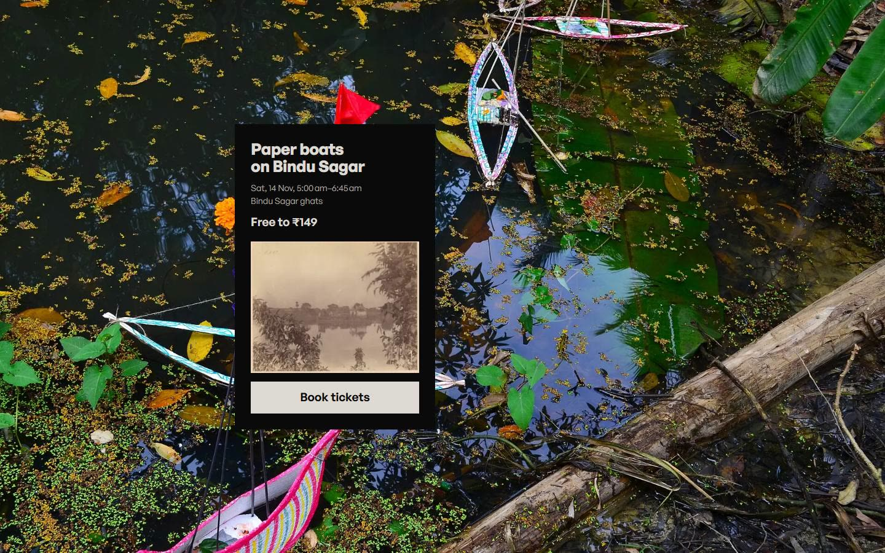 | 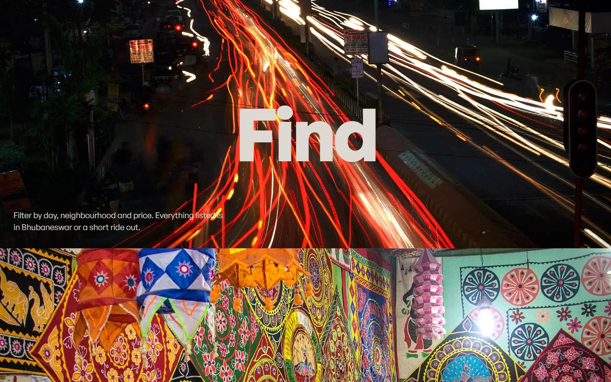 |
| **Coming up.** Full-bleed close-ups with a booking card that steps one column right each time. | **How it works.** One verb per screen (Find, Book, Go), held while its photograph passes. |
| 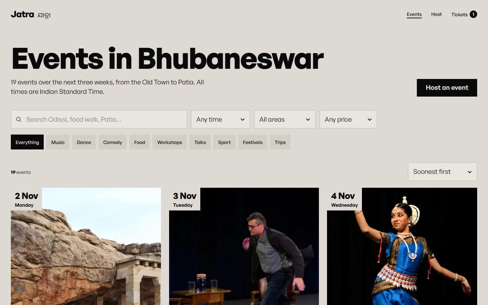 | 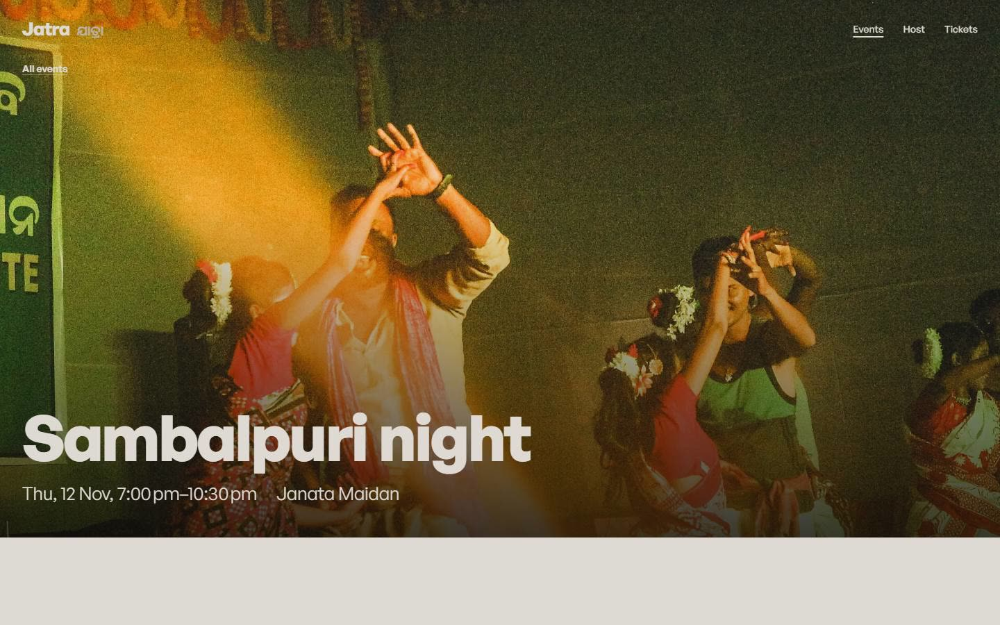 |
| **Browse** with search, filters and sorting. | **Event page** with schedule, details and tiered tickets. |
| 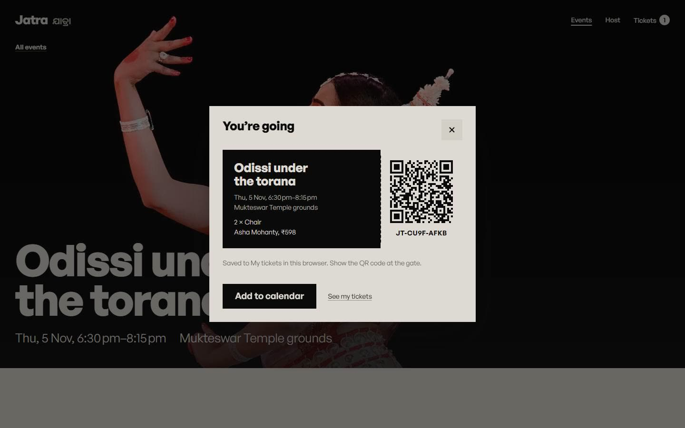 | 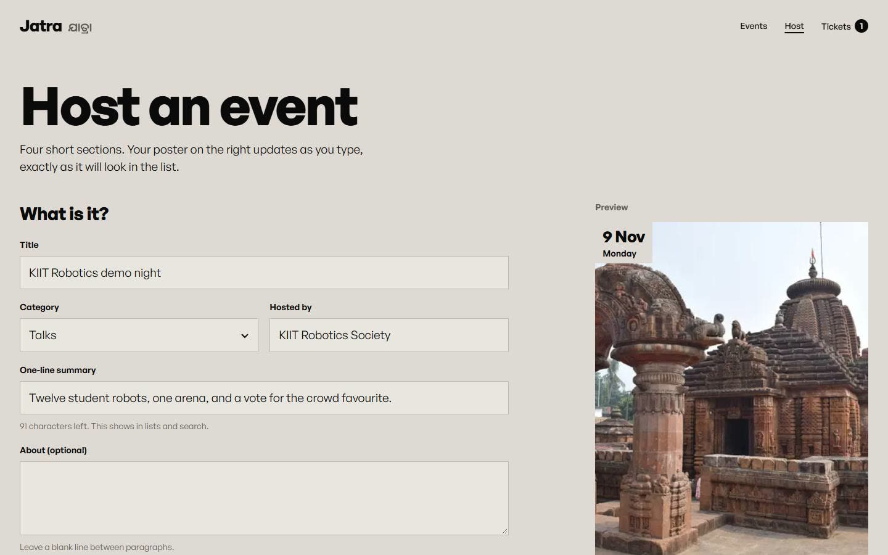 |
| **Booking:** the ticket prints with its QR code. | **Hosting:** inline validation and a live poster preview. |
| 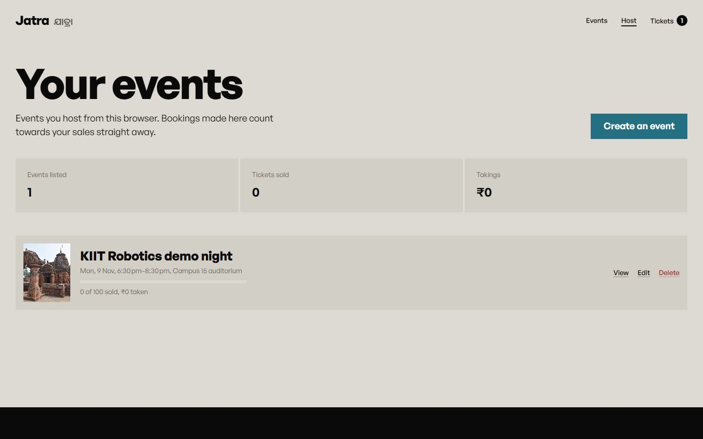 | 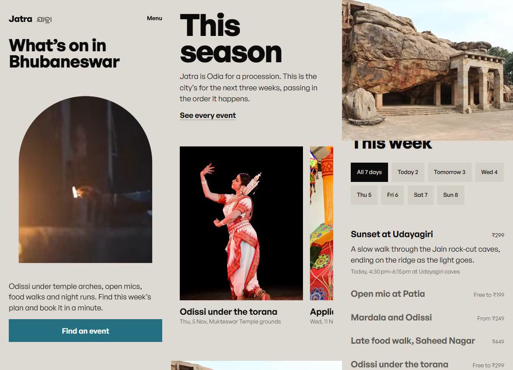 |
| **Dashboard:** what is listed, what has sold. | **On a phone:** each section has its own phone composition. |
| 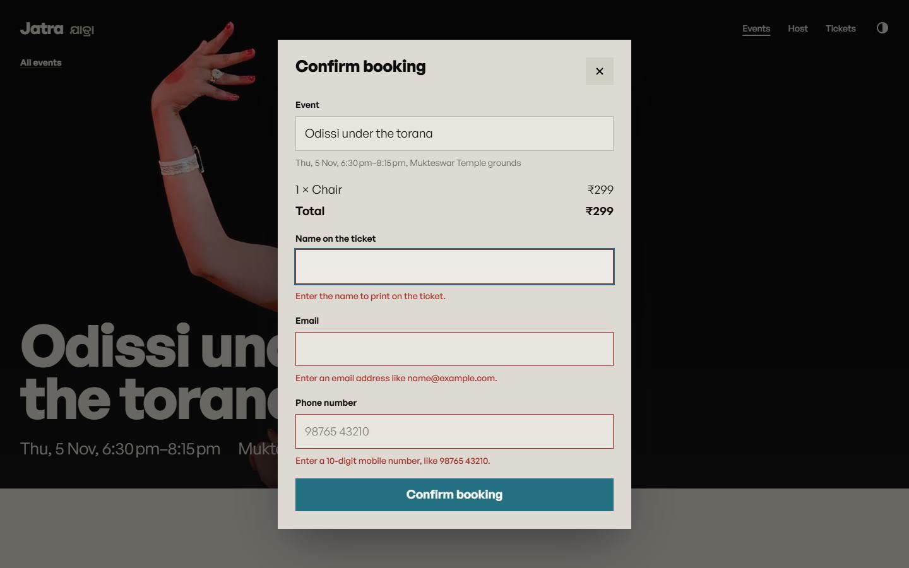 | 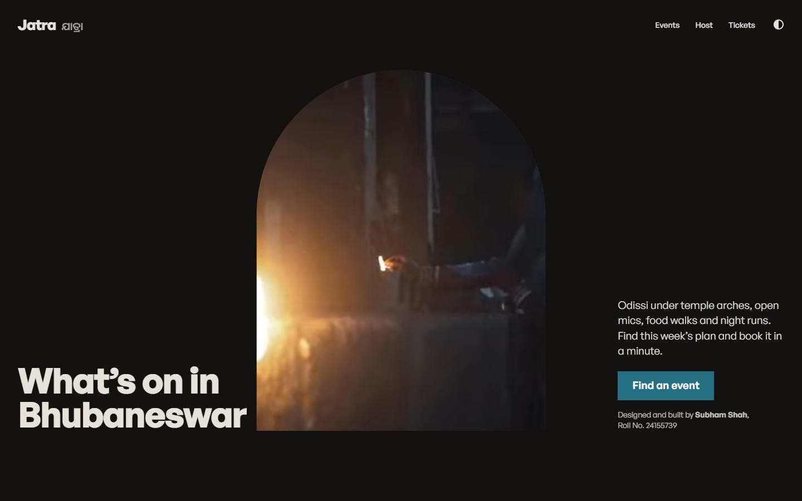 |
| **Registration:** event, name, email and phone, each validated. | **Dark theme:** the Old Town after sunset. |

## The design

The brief was an event site, so the identity comes from the city rather than from event clichés.

- **Idea.** *Jatra* means procession. On the home page the title "This season" holds still while the season's events pass by sideways, the way a procession passes someone standing at the roadside.
- **First screen.** A window shaped like the Mukteswar *torana* (the tenth-century stone arch in the Old Town) shows a film of Odissi dancers among the temples. As you scroll, the arch opens to fill the screen, then the next section slides over it.
- **Palette.** Putty (`#dedad3`), the colour of the Old Town's sandstone, with black ink and a single teal (`#256f82`) for the main action. The host section takes a red sampled from Pipili appliqué cloth (`#a12a1e`). The dark theme swaps ground and ink (`#121110` and `#e6e2da`) and keeps the teal and red.
- **Type.** One family, General Sans, set very large against plain 19px text. The name also appears in Odia script (Noto Sans Oriya).
- **Pictures.** Real photographs and film of Bhubaneswar and Odisha (temples, Odissi, Gotipua, Pipili appliqué, Pattachitra, Raghurajpur, Kalinga Stadium, Boita Bandana boats), all from Wikimedia Commons and credited on [/credits](https://jatra-bhubaneswar.vercel.app/credits).
- **House rules.** No gradients (except neutral scrims over photos), no glass, no shadows on things at rest, no eyebrow labels, no icon-card grids, no hairline dividers, square corners throughout and the arch as the one curve.

The full token sheet is in [DESIGN.md](DESIGN.md).

### Motion

| Moment | How it's built |
| --- | --- |
| Hero window opens to full-bleed | GSAP ScrollTrigger scrubbing a CSS custom property that drives `clip-path: inset(... round ...)` and a 1.14→1 settle on the film |
| First frame | Headline lines rise from behind their baselines, the window wipes open, sentence and button arrive, all settled by about 1.2s (CSS keyframes, no preloader) |
| The procession | Sticky stage pinned with ScrollTrigger, one pixel of scroll per pixel of travel; native swipe row with snapping on phones; keyboard focus scrolls to the focused event |
| Headings | Characters rise from per-word masks (server-rendered spans, `aria-label` keeps the heading readable) |
| Pictures | Shutter reveals (clip-path) and a slight scale settle, once, on entry |
| Lists | Motion (`motion/react`) layout animations when filters change |
| Booking | Native `<dialog>` with `@starting-style` entry; the ticket prints in with a clip-path |
| Countdown | Each digit rolls in as it changes |
| Theme switch | View Transitions API: the new theme wipes down over the old one |
| Feedback | 0.97 press scale on every button, hover only on hover-capable pointers |
| Smoothness | Lenis smooth scroll on mouse and trackpad only, off for touch |

Every hidden state lives inside `prefers-reduced-motion: no-preference`. With reduced motion the hero shows the open film with its headline, and nothing travels.

## How it is built

- **Next.js 16** (App Router, React 19, TypeScript), deployed on **Vercel**.
- **Rendering:** every route is static. The home, browse and event pages use ISR (`revalidate = 3600`) because the sample events are dated relative to today in IST. Event pages are pre-generated with `generateStaticParams`. An organizer's own events are not on the server, so the event page looks them up in the browser that created them.
- **Theme:** a small script in `<head>` sets `data-theme` before the first paint (saved choice, else the system setting), so there is no flash. Dark tokens override the light ones under `:root[data-theme="dark"]`.
- **State:** `src/lib/store.ts` wraps `localStorage` in `useSyncExternalStore`. The server snapshot is empty and the client snapshot is cached by raw string, so hydration is stable and every tab stays in sync (it also listens to the `storage` event).
- **Dates:** everything is formatted with `Intl.DateTimeFormat` in `Asia/Kolkata`, so the server and the browser agree.
- **Tickets:** codes come from `crypto.getRandomValues`. QR codes are SVG from `qrcode` and encode a link to the ticket. Calendar files are generated client-side.
- **Images:** pictures are pre-encoded to WebP at 640, 1080 and 1920px (`public/img/opt`). A custom `next/image` loader (`src/lib/image-loader.ts`) picks the variant for each `srcset` width, so pictures come straight from the CDN with immutable caching instead of being optimised on first request.
- **Styling:** one stylesheet (`src/app/globals.css`) of design tokens and section styles, with Tailwind v4 for the reset.

```
src/
  app/            routes: / · /events · /events/[slug] · /tickets · /host · /host/new · /credits
  components/     Hero, Season (procession), ThisWeek, Browse, EventView, HostForm, Dashboard,
                  TicketsList, Ticket, Poster, Countdown, Header (+ theme toggle), Footer,
                  Motion (Lenis + reveals), Split, Toast
  lib/            events.ts (types, sample data, IST formatting), store.ts (localStorage), media.json (credits)
public/img        photographs (+ opt/ WebP variants), public/media: the hero film (WebM + MP4) and its poster
```

### Accessibility

- Semantic landmarks, a skip link, and one `h1` per page.
- Every control works from the keyboard, with visible focus rings in the accent colour.
- Steppers, chips and day buttons expose `aria-pressed` or `aria-label` state.
- The booking dialog and phone menu use native `<dialog>`, which traps focus.
- Form errors are tied to their fields with `aria-describedby`, and an error summary takes focus.
- Live regions announce results counts and toasts.
- Contrast is AA or better, touch targets are at least 44px, and reduced motion is respected throughout.

## Running it locally

```bash
npm install
npm run dev        # http://localhost:3000
npm run build && npm start
```

Node 22 or later.

### Adding a picture

Put the JPG in `public/img/`, add its credit to `src/lib/media.json`, then encode the WebP variants:

```bash
cd public/img && n=my-picture && for s in 640 1080 1920; do ffmpeg -i $n.jpg -vf "scale='min($s,iw)':-2" -c:v libwebp -quality 74 opt/$n-$s.webp; done
```

## How it was designed

The work followed several installed design skills:

- [Taste Skill](https://github.com/leonxlnx/taste-skill) dealt the art direction ("the pinned poster", General Sans, putty and black) from its library of studied gallery sites. Its browser inspector and source linter checked the house rules at 1440, 768 and 390px, and every FAIL was fixed.
- [Impeccable](https://github.com/pbakaus/impeccable) supplied the product record ([PRODUCT.md](PRODUCT.md)), the craft floor, and its design detector, which reports no findings.
- [Emil Kowalski's skills](https://github.com/emilkowalski/skills) shaped the motion: easing and duration tables, transitions over keyframes for UI, `scale(0.97)` press feedback, hover gated to fine pointers, and reduced motion.
- [UI/UX Pro Max](https://github.com/nextlevelbuilder/ui-ux-pro-max-skill) and Anthropic's frontend-design guidance were used for accessibility and the anti-template checks.

Restore the skills locally with `npx skills experimental_install` (from `skills-lock.json`).

## Credits and licences

- Photographs and the film *The City of Legends: Bhubaneshwar* are from Wikimedia Commons under CC BY and CC BY-SA licences. Each one is credited on [/credits](https://jatra-bhubaneswar.vercel.app/credits). They show the city and its traditions, not Jatra events.
- General Sans is by the Indian Type Foundry (Fontshare, ITF Free Font License). Noto Sans Oriya is under the SIL Open Font License.
- Sample events, hosts, prices and bookings are fictional.

## What would come next

A real backend (Postgres through the Vercel Marketplace) with accounts for organizers, payments, email confirmations with the ticket attached, and a scanner page for hosts to check tickets in at the gate.
